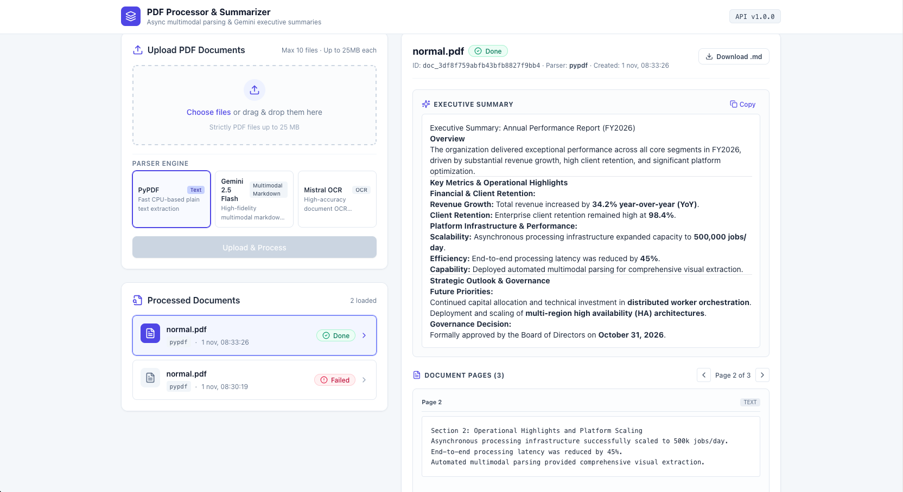

# Description

**PDF Processor** is an asynchronous document processing application. Users upload one or more PDF files through a web interface, choose a parsing method, and get back the content of each file page by page, plus one summary per file.



### How it works

1. **Upload**: the React frontend sends the PDFs and the chosen parser (`pypdf`, `gemini` or `mistral`) to the FastAPI backend, which validates the files and responds immediately with `202 Accepted`.
2. **Queue**: each file becomes a job in a **Redis Streams** queue, so uploads never block on parsing.
3. **Processing**: one or more workers, running as a consumer group, pick up the jobs and extract the content:
   - **PyPDF**: fast, plain-text extraction.
   - **Google Gemini** (`gemini-2.5-flash`): converts the PDF to markdown.
   - **Mistral OCR**: converts the PDF to markdown, useful for scanned documents.
4. **Summarization**: Gemini generates one summary per document, whichever parser was used.
5. **Results**: the frontend polls the API and shows the status of each document (`queued` → `processing` → `summarizing` → `done` | `failed`), the per-page content and the summary as soon as they are available.

### Highlights

- **Contract-first**: the OpenAPI contract is the single source of truth. The backend is checked against it and the frontend generates its types from it.
- **Reliable async processing**: at-least-once delivery, retries with backoff, a dead-letter stream, recovery of stuck jobs and graceful shutdown. Workers scale horizontally with `docker compose up --scale worker=N`.
- **Resilient by design**: a summary failure keeps the already parsed pages, and the app starts and works with PyPDF even without API keys.
- **Fully containerized**: the whole stack runs with Docker Compose.

### Tech stack

Python 3.12 · FastAPI · Redis 7 (Streams) · PyPDF · Google Gemini · Mistral OCR · React + TypeScript · Docker Compose

### Suggested change breakdown

The changes to be documented by Openspec and implemented by agents are:

1. **api-contract**: contracts/openapi.yaml with schemas, statuses, and errors.
2. **backend-pypdf-upload**: FastAPI, upload, PyPDF parsing, Redis storage.
3. **redis-streams-worker**: consumer group, a separate worker container, retries.
4. **gemini-summary-and-parsing**: summary plus Gemini markdown parser.
5. **mistral-ocr**: OCR parser.
6. **frontend-react**: upload, parser selector, polling, results view.
7. **docker-compose-hardening**: healthchecks, README, edge cases.

The input and out agent prompts details for each change will be explain later from this document.

### Tips for the contract change

- Put the parser in an enum (pypdf, gemini, mistral), so adding Mistral later doesn’t change the contract.
- Make upload return 202 Accepted with a document_id and status.
- Define a single error schema (code, message) used across all endpoints.
- Add GET /documents/{id} for the status and result, and GET /documents for the list.
- Have FastAPI validate against the same schema (or export its generated OpenAPI and diff it against the contract). The frontend can then generate its types from it.

## Multirepo bwaai2 architecture:
The project is split into three repositories that live side by side. The spec-driven workflow with OpenSpec keeps them aligned around a single API contract.

### Configure multirepo bwaai2 folders
1. Create openspec bwaai2 main folder:
```shell
mkdir /Users/miguel/git/bwaai2
```

2. Create bwaai2 openspec store folder:
```shell
openspec store setup
✔ Store name bwaai2-store
✔ Where should this store live? /Users/miguel/git/bwaai2/bwaai2-store
```

3. Create bwaai2 backend folder:
```shell
mkdir /Users/miguel/git/bwaai2/bwaai2-backend
```

4. Create bwaai2 frontend folder:
```shell
mkdir /Users/miguel/git/bwaai2/bwaai2-frontend
```

5. Register bwaai2 openspec workset:
```shell
openspec workset create bwaai2 \
  --member /Users/miguel/git/bwaai2/bwaai2-backend \
  --member /Users/miguel/git/bwaai2/bwaai2-frontend \
  --member /Users/miguel/git/bwaai2/bwaai2-store
```

6. Set bwaai2 openspec store folder and start your agent:
```shell
cd /Users/miguel/git/bwaai2/bwaai2-store
agy
```

### `bwaai2-store`: specs and contract

The **OpenSpec store**. It holds no application code, only the specifications that drive the implementation and final delivery.

- `docs/`: original BWAAI2 Test Task documentation.
- `images/`: BWAAI2 Test Task images.
- `contracts/openapi.yaml`: the OpenAPI contract, the single source of truth between backend and frontend.
- `openspec/changes/`: one folder per change, each with `proposal.md`, `design.md`, `specs/` and `tasks.md`. Changes were implemented in order: `api-contract`, `backend-pypdf-upload`, `redis-streams-worker`, `gemini-summary-and-parsing`, `mistral-ocr`, `frontend-react` and `docker-compose-hardening`.
- `delivery/`: assets used to package the final deliverable (root `docker-compose.yml`, scripts, samples and the main README). 
- `dist/`: is the generated output folder of the packaging step (make package), holding the delivery copy (staging/) and the final zip, and it can be safely deleted and rebuilt at any time.

### `bwaai2-backend`: API and workers

The **Python 3.12 + FastAPI** backend, and the core of the application.

- **API**: upload, list, status and result endpoints, exactly as defined in the contract. Uploads are validated and answered with `202 Accepted`.
- **Redis**: stores documents, pages and summaries, and uses **Redis Streams** as the job queue.
- **Worker**: a separate process (consumer group) that parses each PDF with PyPDF, Gemini or Mistral OCR, then generates the summary with Gemini. It handles retries, a dead-letter stream, recovery of stuck jobs and graceful shutdown.
- **Quality**: pytest suite with mocked external APIs, ruff, and a test that checks the generated OpenAPI against the contract.

### `bwaai2-frontend`: web interface

The **React + TypeScript** single-page app (Vite).

- Drag-and-drop upload of one or more PDFs, with a parser selector.
- Live status of each document through polling (`queued`, `processing`, `summarizing`, `done`, `failed`).
- Per-page result viewer with rendered markdown and the document summary, plus copy and download actions.
- Typed API client generated from the contract (`openapi-typescript`), tests with Vitest and MSW, and an nginx image that proxies `/api` to the backend.

## Change 01: generate openAPI contract
Create the first change to create the contract between backend and frontend.

```shell
Create an OpenSpec change named `api-contract`.

SCOPE: ONLY the OpenAPI 3.1 (Swagger) contract. Do NOT write any application code, Dockerfiles, or tests. The output is the spec plus a single contract file at `contracts/openapi.yaml`.

CONTEXT
Async PDF processing app. Backend: Python 3.12 + FastAPI, Redis 7 (Streams as queue). Frontend: React. The contract is the single source of truth between backend and frontend (the frontend will generate TypeScript types from it, the backend will validate its generated OpenAPI against it).

FLOW
1. The client uploads 1..N PDF files in one request, choosing a parser: `pypdf`, `gemini` or `mistral`.
2. The API stores the files, enqueues one job per file and responds immediately with 202 Accepted.
3. A worker parses each PDF (pypdf = plain text; gemini/mistral = markdown), then generates ONE summary per file with Gemini.
4. The client polls to get status and, when ready, the per-page content and the summary.

REQUIREMENTS FOR THE CONTRACT
- `POST /documents`: multipart/form-data with `files[]` (1..N, application/pdf) and `parser` (enum: pypdf | gemini | mistral, default pypdf). Returns 202 with a list of `{document_id, filename, status}`.
- `GET /documents`: list documents with `status`, `parser`, `filename`, timestamps. Include simple pagination (`limit`, `cursor`).
- `GET /documents/{document_id}`: status plus, when `done`, the result: `pages[]` (`page_number`, `content`, `format`: text | markdown) and `summary`. When `failed`, include the error.
- `GET /documents/{document_id}/status` (lightweight, for polling) with optional `Retry-After` header.
- `GET /health`.
- Status lifecycle enum: `queued | processing | done | failed`.
- A single reusable `Error` schema (`code`, `message`, optional `details`) used by every 4xx/5xx response, with an enum of error codes: INVALID_FILE_TYPE, FILE_TOO_LARGE, ENCRYPTED_PDF, EMPTY_FILE, TOO_MANY_FILES, PARSER_UNAVAILABLE, DOCUMENT_NOT_FOUND, PARSER_FAILED, SUMMARY_RATE_LIMITED.
- Document the limits (max file size, max files per request) as `x-` extensions or in descriptions, and mark assumptions explicitly.
- Reusable `components/schemas` and `components/responses`; no inline duplication. Add realistic `examples` for every request and response.
- Every operation needs `operationId`, `summary`, `tags` (documents, system) and all possible status codes (202, 200, 400, 404, 413, 415, 422, 429, 500).

DELIVERABLES
- `proposal.md`: why, scope, out of scope (no code).
- `design.md`: key decisions (polling vs SSE, why 202, why per-file jobs, why a status endpoint) and the assumptions you made.
- `specs/`: requirements and scenarios for each endpoint.
- `tasks.md`: small checklist: write the YAML, validate it (e.g. with `openspec validate` and an OpenAPI linter such as Spectral/Redocly), review.
- `contracts/openapi.yaml`: the full contract.

If anything is ambiguous, state a reasonable assumption in `design.md` and continue instead of asking.
```

Result:

```shell
The OpenSpec change api-contract and the authoritative OpenAPI 3.1 contract have been created and strictly validated.

### Delivered Artifacts

1. `proposal.md`: Outlines motivation, capabilities (document-processing, system-health), strict scope (OpenAPI 3.1 contract only), and exclusions (no application code, workers, or tests).
2. `design.md`: Documents architectural decisions (HTTP polling with Retry-After vs. SSE/WebSockets, immediate 202 Accepted for async ingestion, per-file Redis Stream jobs, lightweight /status endpoint) and all operational assumptions.
3. Delta Specs:
    * `spec.md`: Requirements and scenarios covering `POST /documents`, `GET /documents`, `GET /documents/{document_id}`, `GET /documents/{document_id}/status`, and standardized error handling.
    * `spec.md`: Requirement and scenarios for `GET /health`.
4. `tasks.md`: Trackable implementation, verification, and linting checklist.
5. `openapi.yaml`: The complete OpenAPI 3.1 contract.

---

### Contract Highlights & Schema Design

* Endpoints & Operations:
    * `POST /documents` (uploadDocuments): Multipart upload supporting 1..10 PDF files with parser selection (`pypdf`, `gemini`, `mistral`), returning `202 Accepted` with a list of `DocumentUploadItem` objects.
    * `GET /documents` (listDocuments): Chronological listing with cursor pagination (`limit`, `cursor`) returning `DocumentListResponse`.
    * `GET /documents/{document_id}` (getDocument): Full document details returning `DocumentDetailResponse` with `pages[]` (`page_number`, `content`, `format`: `text` | `markdown`), single consolidated Gemini summary when done, or Error details when failed.
    * `GET /documents/{document_id}/status` (getDocumentStatus): Lightweight polling endpoint returning `DocumentStatusResponse` with optional `Retry-After` header.
    * `GET /health` (getHealth): Liveness and dependency diagnostic check under the `system` tag.
* Unified Error Model:
    * Reusable Error schema used across all 4xx/5xx responses, with the 9 enum codes in `ErrorCode`: `INVALID_FILE_TYPE`, `FILE_TOO_LARGE`, `ENCRYPTED_PDF`, `EMPTY_FILE`, `TOO_MANY_FILES`, `PARSER_UNAVAILABLE`, `DOCUMENT_NOT_FOUND`, `PARSER_FAILED`, and `SUMMARY_RATE_LIMITED`.
* Limits & Extensions:
    * Documented in operation descriptions and `x-` extensions: `x-max-files-per-request: 10`, `x-max-file-size-bytes: 26214400` (25MB), and `x-recommended-poll-interval-seconds: 3`.

---

### Validation Results

* OpenSpec Strict Validation:
    ```bash
    openspec validate api-contract --strict
    # Result: Change 'api-contract' is valid
    ```
* Redocly OpenAPI 3.1 Lint:
    ```bash
    npx -y @redocly/cli lint contracts/openapi.yaml
    ```
```

## Change 02: backend pypdf upload

```shell
Create the OpenSpec change `backend-pypdf-upload`.

REPOSITORY LAYOUT (IMPORTANT)
This is a multi-repo setup:
- `bwaai2-store` (current repo, OpenSpec store): ONLY specs and contracts live here.
  - `contracts/openapi.yaml` is the source of truth (do NOT modify it).
  - `openspec/changes/backend-pypdf-upload/` holds proposal.md, design.md, specs/, tasks.md.
- `bwaai2-backend` (at `../bwaai2-backend`): ALL backend code, tests, Dockerfile and docker-compose.yml live here.

RULES
- NEVER create application code, tests, Dockerfiles, pyproject, or compose files inside `bwaai2-store`.
- Write ALL code under `../bwaai2-backend`, with its layout at the repo root (no extra `backend/` subfolder): `app/`, `tests/`, `pyproject.toml`, `Dockerfile`, `docker-compose.yml`, `Makefile`.
- Read the contract from `../bwaai2-store/contracts/openapi.yaml` (configurable path via env var `CONTRACT_PATH` for the contract-check test; do not copy it into the backend repo).
- In `tasks.md`, prefix every task with the target repo: `[store]` or `[backend]`. Tick tasks as you complete them.
- If `bwaai2-store` already contains code from a previous run, move it to `bwaai2-backend` and delete it from the store. Report what you moved.

SCOPE
Backend only (Python 3.12 + FastAPI + Redis 7). Implement the contract endpoints with the `pypdf` parser. `gemini` and `mistral` are accepted by validation but return `PARSER_UNAVAILABLE` for now. Summaries are out of scope (summary stays null). Out of scope: Redis Streams consumer/worker, Gemini, Mistral, frontend.

WHAT TO BUILD (in bwaai2-backend)
1. Layout: `app/api/` (routers), `app/core/` (pydantic-settings, logging), `app/models/` (schemas matching the contract), `app/services/` (storage, queue, parsers), `app/main.py`.
2. Endpoints exactly as in the contract: POST /documents, GET /documents, GET /documents/{id}, GET /documents/{id}/status, GET /health.
3. Upload validation: content type AND magic bytes (`%PDF-`), max file size, max files per request, empty file, encrypted PDF -> error codes from the contract.
4. Redis storage with `redis.asyncio` (one shared pool created in lifespan): `doc:{id}` hash, pages/summary keys, `docs:index` sorted set for listing and cursor pagination, original PDF bytes with a configurable TTL.
5. Queue producer: `XADD` to stream `documents:jobs` (document_id, parser) and set status `queued`. Stream name, group name and message format go in one constants module for the future worker.
6. `Parser` interface (`async def parse(pdf_bytes) -> list[Page]`) with the PyPDF implementation run via `asyncio.to_thread`. Not called from the request handler; exposed as a service with unit tests.
7. Fully async handlers, streamed upload reading with size limit.
8. Dockerfile + docker-compose.yml with `api` and `redis` (healthchecks, env file, named volume).
9. Tests (pytest + httpx AsyncClient + fakeredis): happy path, invalid file, too large, encrypted PDF, unknown id, pagination, concurrent uploads, plus a contract check comparing FastAPI's generated OpenAPI against the contract file.
10. Ruff config and Makefile with `up`, `test`, `lint`.

DELIVERABLES
- In the store: `proposal.md`, `design.md` (Redis data model, why parsing is not in the request path, why PDFs are stored in Redis, limits chosen, multi-repo decisions), `specs/` with scenarios per endpoint, `tasks.md`.
- In the backend repo: the implementation, tests passing and lint clean.

If anything is ambiguous, write a reasonable assumption in `design.md` and continue.
```

Result:

```shell
### Repository Layout Separation

* bwaai2-store (Store Repo):
    * Contains only specification and contract governance files.
    * No application code, tests, Dockerfiles, or compose files were kept or added here.
    * Contract source of truth: openapi.yaml (untouched).
    * OpenSpec deliverables:
        * proposal.md
        * design.md
        * spec.md
        * tasks.md (all tasks prefixed with [store] or [backend] and checked off).

* bwaai2-backend (Implementation Repo):
    * All application code resides at the root without nested backend/ subfolders:
        * app/api/: documents.py, health.py
        * app/core/: config.py, constants.py, exceptions.py, logging.py
        * app/models/: documents.py, errors.py, health.py
        * app/services/: storage.py, queue.py, parsers/ (base.py, pypdf_parser.py, llm_parsers.py)
        * app/main.py: main.py with lifespan connection pooling and unified contract exception handlers
        * tests/: test_documents.py, test_status.py, test_health.py, test_pypdf_parser.py, test_concurrency.py, test_contract.py
        * Tooling: pyproject.toml, Dockerfile, docker-compose.yml, Makefile, .env.example.

---

### Implementation Details

1. Validation Pipeline:
    * Streamed chunk reading enforcing 25MB (26,214,400 bytes) limit per file.
    * Batch count enforcement (max 10 files per request).
    * Validation against MIME type (application/pdf) and magic bytes (%PDF-).
    * Pre-flight encryption check via PdfReader.is_encrypted -> returns HTTP 400 with ENCRYPTED_PDF.
    * Empty files (0 bytes) -> returns HTTP 400 with EMPTY_FILE.
    * Parsers gemini and mistral pass schema validation but raise HTTP 500 with PARSER_UNAVAILABLE.

2. Redis 7 Storage & Queue:
    * Single connection pool initialized during FastAPI lifespan and cleanly closed on shutdown.
    * Document metadata stored as doc:{id} hash.
    * Raw PDF bytes stored at doc:{id}:file with configurable TTL (PDF_TTL_SECONDS=86400).
    * Document indexing and cursor pagination backed by docs:index sorted set (score = epoch_timestamp).
    * Jobs published via XADD to documents:jobs with payload { "document_id": "...", "parser": "..." }.

3. PyPDF Parser Service:
    * Implements abstract BaseParser protocol.
    * Runs off the event loop via asyncio.to_thread to prevent CPU-bound event loop blocking.
    * Not called in the HTTP request path (reserved for the asynchronous worker).

4. OpenAPI Parity Test:
    * Tests FastAPI's generated OpenAPI against CONTRACT_PATH (../bwaai2-store/contracts/openapi.yaml): verifies all paths (/documents, /documents/{document_id}, /documents/{document_id}/status, /health), HTTP methods, operation IDs, status codes, and component schemas.

---

### Test & Lint Verification

Ran from bwaai2-backend:

# 1. Full Pytest Suite (19 passed in 0.17s)
uv run pytest -v

# 2. Ruff Lint & Format Checks (100% clean)
uv run ruff check .
uv run ruff format --check .

# 3. OpenSpec Strict Validation (Store)
openspec validate backend-pypdf-upload --strict
# Change 'backend-pypdf-upload' is valid
```

## Change 03: redis-streams-worker

```shell
Create and implement the OpenSpec change `redis-streams-worker`.

REPOSITORY LAYOUT (IMPORTANT)
Multi-repo setup:
- `bwaai2-store` (current repo, OpenSpec store): ONLY specs and contracts.
  - `contracts/openapi.yaml` is the source of truth (do NOT modify it).
  - `openspec/changes/redis-streams-worker/` holds proposal.md, design.md, specs/, tasks.md.
- `bwaai2-backend` (at `../bwaai2-backend`): ALL code, tests, Dockerfile, docker-compose.yml.

RULES
- NEVER create code, tests, Dockerfiles or compose files inside `bwaai2-store`.
- Prefix every task in `tasks.md` with `[store]` or `[backend]`. Tick tasks as you complete them.
- Reuse what `backend-pypdf-upload` already built: the constants module (stream name `documents:jobs`, group name, message format), the Redis storage service, the `Parser` interface and the PyPDF parser. Do NOT duplicate them. If something must change, change it in place and note it in `design.md`.

SCOPE
Implement the asynchronous consumer that processes uploaded documents with PyPDF and stores the results in Redis.
Out of scope: Gemini summary, Gemini parser, Mistral, frontend. For `gemini` and `mistral` jobs, mark the document `failed` with error code `PARSER_UNAVAILABLE` (no retries, ack the message).

WHAT TO BUILD (in bwaai2-backend)
1. Worker entrypoint `app/worker/main.py` (run with `python -m app.worker`), separate process and separate `worker` service in docker-compose.yml using the same image as the API (different command), with healthcheck or heartbeat key, env file and `depends_on: redis (healthy)`.
2. Consumer group:
   - Create the group idempotently on startup (`XGROUP CREATE ... MKSTREAM`, ignore BUSYGROUP).
   - Unique consumer name per instance (hostname + pid/uuid), so `docker compose up --scale worker=3` works.
   - Loop with `XREADGROUP` (block timeout, batch size configurable), concurrency per worker limited by an `asyncio.Semaphore` (env `WORKER_CONCURRENCY`).
3. Job processing:
   - Set status `processing` (+ `started_at`), load PDF bytes, run the parser, store pages and set `done` (+ `finished_at`) atomically (pipeline/transaction).
   - `XACK` only AFTER results are stored (at-least-once delivery). Processing must be idempotent: if the document is already `done`, just ack.
   - If the PDF bytes expired or the document does not exist, mark `failed` / ack, never loop.
4. Error handling and retries:
   - Classify errors: permanent (corrupt/encrypted PDF -> `PARSER_FAILED` / `ENCRYPTED_PDF`) vs transient (Redis errors, timeouts).
   - Transient: no ack, retried by redelivery up to `MAX_ATTEMPTS` (track attempts with delivery count from `XPENDING` or an attempts field). Add backoff.
   - After `MAX_ATTEMPTS` or a permanent error: set `failed` with the contract error code, move the message to a dead-letter stream `documents:dead` with the reason, then `XACK`.
5. Recovery of stuck messages: periodic `XAUTOCLAIM` of messages pending longer than `CLAIM_IDLE_MS` (crashed worker), reprocessing them through the same path.
6. Graceful shutdown: handle SIGTERM/SIGINT, stop reading, finish in-flight jobs (with timeout), then exit. Reconnect with backoff if Redis goes away.
7. Structured logging with document_id, consumer name and attempt on every log line.
8. Tests (pytest, fakeredis or a Redis testcontainer if XAUTOCLAIM is not supported by fakeredis):
   - happy path: upload -> worker -> status `done` with pages.
   - corrupt/encrypted PDF -> `failed` with the right code, message acked, entry in dead-letter.
   - transient failure retried then succeeds; exceeding MAX_ATTEMPTS goes to dead-letter.
   - crashed worker: pending message claimed by another consumer.
   - idempotency: same message processed twice yields one result.
   - two workers consuming in parallel never process the same message twice.
   - gemini/mistral jobs -> `PARSER_UNAVAILABLE`.
9. Update Makefile (`worker`, `up` runs api + worker + redis) and README section "Running the worker / scaling".
10. End-to-end check with curl: upload a sample PDF, poll `GET /documents/{id}/status` until `done`, fetch `GET /documents/{id}`. Document the commands in the README.

DELIVERABLES
- Store: `proposal.md`, `design.md` (delivery semantics, retry/backoff policy, DLQ format, XAUTOCLAIM strategy, shutdown behavior, config table with defaults), `specs/` with scenarios, `tasks.md`.
- Backend: implementation, tests passing, lint clean.

If anything is ambiguous, write a reasonable assumption in `design.md` and continue.
```

Result:

```shell
The OpenSpec change `redis-streams-worker` and its backend implementation in `bwaai2-backend` are complete.

### Repository Layout Separation

* `bwaai2-store` (Store Repo):
    * Contains only OpenSpec specifications and OpenAPI contracts.
    * Deliverables:
        * `proposal.md`
        * `design.md`: Documents delivery semantics, retry and backoff policy, DLQ message format, `XAUTOCLAIM` recovery strategy, graceful drain, and the configuration table.
        * `spec.md`: Requirements and scenarios for consumer group ingestion, status lifecycle transitions, and unsupported parser handling.
        * `spec.md`: Requirements and scenarios for permanent error DLQ routing, transient failure retries, and `XAUTOCLAIM` orphan job recovery.
        * `tasks.md`: All tasks tagged with `[store]` or `[backend]` and ticked.

* `bwaai2-backend` (Implementation Repo):
    * `processor.py`: JobProcessor executing status transitions (`processing`, `done`, `failed`), PyPDF text parsing off-thread, and `XACK`ing strictly after atomic result storage.
    * `consumer.py`: StreamConsumer with idempotent consumer group creation (`documents:workers`), dynamic consumer naming (`hostname-pid-uuid`) for scaling, and throttled batch reading via `asyncio.Semaphore(WORKER_CONCURRENCY)`.
    * `autoclaim.py`: Periodic background `XAUTOCLAIM` loop recovering stuck or abandoned jobs idle > `CLAIM_IDLE_MS`.
    * `main.py` and `__main__.py`: Worker daemon entrypoint with `SIGTERM`/`SIGINT` graceful drain and periodic heartbeat key updates (`worker:heartbeat:{consumer_name}`).
    * `docker-compose.yml`: Added worker service with heartbeat healthchecks and Redis dependency.
    * `Makefile`: Added worker target (`uv run python -m app.worker`).
    * `README.md`: Documented horizontal scaling (`docker compose up --scale worker=3`) and end-to-end verification commands with cURL.
    * `test_worker.py`: 7 new comprehensive worker test suites.

---

### Key Technical Mechanisms

1. At-Least-Once Delivery & Idempotency:
    * `XACK` is only executed after page results and `done` status are persisted in Redis.
    * If a duplicate message arrives for an already done document, it is acknowledged immediately without re-parsing.
2. Failure Handling & Dead-Letter Queue:
    * Permanent errors (`ENCRYPTED_PDF`, `INVALID_FILE_TYPE`, `PARSER_FAILED`, expired PDF bytes, or `PARSER_UNAVAILABLE` for gemini/mistral) update status to `failed`, write details to `documents:dead`, and `XACK`.
    * Transient errors remain unacknowledged up to `MAX_ATTEMPTS` (tracked via `XPENDING`), routing to `documents:dead` only upon exceeding the retry limit.
3. Orphan Recovery via `XAUTOCLAIM`:
    * Reclaims pending messages idle for longer than `CLAIM_IDLE_MS` (60s default) from crashed workers and re-processes them.
4. Horizontal Scaling:
    * Unique consumer names ensure multiple worker replicas (`docker compose up --scale worker=3`) distribute jobs across the consumer group without collisions.

---

### Verification Results

Ran from `bwaai2-backend`:

```bash
# 1. Full Pytest Suite (26 passed in 0.33s)
uv run pytest -v

# 2. Ruff Lint & Format Checks (100% clean)
uv run ruff check .
uv run ruff format --check .

# 3. OpenSpec Strict Validation (Store)
openspec validate redis-streams-worker --strict
# Change 'redis-streams-worker' is valid
```

## Change 04: gemini-summary-and-parsing

```shell
Create and implement the OpenSpec change `gemini-summary-and-parsing`.

REPOSITORY LAYOUT (IMPORTANT)
Multi-repo setup:
- `bwaai2-store` (current repo, OpenSpec store): ONLY specs and contracts.
  - `contracts/openapi.yaml` is the source of truth. In THIS change you ARE allowed to modify it, but only as described in section A.
  - `openspec/changes/gemini-summary-and-parsing/` holds proposal.md, design.md, specs/, tasks.md.
- `bwaai2-backend` (at `../bwaai2-backend`): ALL code, tests, Dockerfile, docker-compose.yml.

RULES
- NEVER create code, tests, Dockerfiles or compose files inside `bwaai2-store`.
- Prefix every task in `tasks.md` with `[store]` or `[backend]`. Tick tasks as you complete them.
- Order of work: contract first (store), then backend. The backend contract-check test must pass against the updated contract.
- Reuse what already exists: constants module, Redis storage service, `Parser` interface, PyPDF parser, worker (consumer group, retries, DLQ, XAUTOCLAIM, graceful shutdown). Do NOT duplicate. Change things in place and note it in `design.md`.

A. CONTRACT CHANGES (store, `contracts/openapi.yaml`) - minimal, nothing else
1. Add `summarizing` to the document status enum. New lifecycle: `queued -> processing -> summarizing -> done | failed`.
2. `GET /documents/{id}` and `GET /documents/{id}/status`: document that `summarizing` means pages are already parsed. In `GET /documents/{id}`, `pages` MUST be returned as soon as the status is `summarizing`, `done`, or `failed` after parsing succeeded (summary is null until `done`). Update schemas, descriptions and examples (add a `summarizing` example and a `failed` example that keeps its pages).
3. Make sure `SUMMARY_RATE_LIMITED` and `SUMMARY_FAILED` exist in the error code enum; add the latter if missing.
4. Do NOT change paths, parameters or any other schema. If you believe another change is needed, list it under "Contract issues" in design.md instead of making it.

SCOPE
Summarization with Gemini for ALL parsers, plus the Gemini PDF-to-markdown parser.
Out of scope: Mistral (keeps returning `PARSER_UNAVAILABLE`), frontend.

B. BACKEND (bwaai2-backend)
1. Gemini client service `app/services/gemini.py`:
   - Official `google-genai` SDK, async API. Model id from env `GEMINI_MODEL` (default `gemini-2.5-flash`), key from `GEMINI_API_KEY`. Never log the key. Never hard-code it; add it to `.env.example` and to the `worker` service in docker-compose.yml.
   - Single wrapper with timeout, and error classification: 429/quota -> `SUMMARY_RATE_LIMITED` (transient), 5xx/timeouts -> transient, 4xx invalid request/blocked content -> permanent.
   - Limit concurrent Gemini calls with a semaphore (env `GEMINI_CONCURRENCY`, default 2) to stay inside the free tier. Exponential backoff with jitter honoring `Retry-After`/retry delay when present.
2. Gemini parser `GeminiParser` implementing the existing `Parser` interface:
   - Send the PDF bytes to Gemini (inline data when small, Files API when large; document the threshold) and ask for markdown per page.
   - Use structured output (JSON schema): `pages: [{page_number, markdown}]`. Validate the response; if the page count does not match the PDF page count (check with pypdf), retry once, then fail with `PARSER_FAILED`.
   - Register it in the parser factory. `gemini` jobs stop returning `PARSER_UNAVAILABLE`; `mistral` still does.
3. Summarizer service `app/services/summarizer.py`:
   - Input: the stored pages (text or markdown) of the document, whatever the parser was. One summary per document.
   - If the text fits in the context budget (env `SUMMARY_MAX_INPUT_CHARS`), single call. Otherwise map-reduce: summarize chunks, then summarize the summaries. Output a concise summary (prompt in English, but write the summary in the document's language).
   - Empty extracted text (e.g. scanned PDF with pypdf) -> store a clear summary-less result: status `done` with `summary` = null is NOT allowed; instead fail with `SUMMARY_FAILED` and a message suggesting the `gemini` parser. Document this in design.md.
4. Worker pipeline update (stages, resumable):
   - `queued -> processing`: parse and store pages (skip if pages already stored, so a retry never re-parses).
   - Atomically set `summarizing` after pages are stored.
   - Summarize, store the summary, set `done` (+ `finished_at`) and only then `XACK`.
   - Summary failure: pages are kept. Transient errors -> normal redelivery with backoff up to `MAX_ATTEMPTS`, resuming at the summarize stage. After exhausting attempts or on a permanent error -> status `failed` with `SUMMARY_RATE_LIMITED` / `SUMMARY_FAILED`, pages preserved, message to dead-letter stream with reason, then `XACK`.
   - Idempotency: processing the same message twice yields one result; a `summarizing` document that is redelivered resumes at the summary stage.
   - Crashed worker in `summarizing` is recovered by the existing XAUTOCLAIM path.
5. API updates: `GET /documents/{id}` and `/status` return `summarizing` and expose pages as soon as they exist, as the updated contract says. Update list filtering/schemas if they reference the status enum.
6. Tests (mock the Gemini client; never call the real API in tests):
   - pypdf upload -> worker -> `summarizing` -> `done` with pages and summary.
   - gemini parser happy path (structured output) and page-count mismatch retry then `PARSER_FAILED`.
   - 429 on summary: retried with backoff, then succeeds; and exhausted -> `failed` with `SUMMARY_RATE_LIMITED`, pages preserved, entry in dead-letter.
   - retry after summary failure does NOT re-run the parser.
   - empty text (scanned PDF with pypdf) -> `failed` with `SUMMARY_FAILED`.
   - long document -> map-reduce path.
   - crashed worker during `summarizing` is claimed and finished by another consumer.
   - mistral still returns `PARSER_UNAVAILABLE`.
   - contract check passes against the updated `openapi.yaml`.
7. README: new env vars (`GEMINI_API_KEY`, `GEMINI_MODEL`, `GEMINI_CONCURRENCY`, `SUMMARY_MAX_INPUT_CHARS`), how to get a free-tier key, and a curl walkthrough showing the `queued -> processing -> summarizing -> done` transitions.

DELIVERABLES
- Store: updated `contracts/openapi.yaml`, `proposal.md`, `design.md` (status lifecycle, resumable stages, failure semantics with pages preserved, chunking strategy, free-tier rate limiting, inline vs Files API threshold, assumptions), `specs/`, `tasks.md`.
- Backend: implementation, tests passing, lint clean.

If anything is ambiguous, write a reasonable assumption in `design.md` and continue.
```

Result:

```shell
The OpenSpec change `gemini-summary-and-parsing` has been fully implemented and verified across both repositories.

### Summary of Changes

#### 1. Store Repository (`bwaai2-store`)

* OpenAPI Contract (`openapi.yaml`):
    * Added `summarizing` to `DocumentStatus` enum (`queued` -> `processing` -> `summarizing` -> `done` | `failed`).
    * Added `SUMMARY_FAILED` to `ErrorCode` enum.
    * Documented that `GET /documents/{document_id}` exposes pages as soon as status is `summarizing`, `done`, or `failed` after parsing succeeds (while summary remains null until `done`).
    * Added `summarizingDocument` and `failedAfterParsing` examples.
    * Verified with Redocly CLI (0 errors, 0 warnings).
* OpenSpec Change Specification (`gemini-summary-and-parsing/`):
    * Authored `proposal.md`, `design.md`, specs (`gemini-parser`, `document-summarizer`, `resumable-pipeline`), and `tasks.md`.
    * Validated with `openspec validate gemini-summary-and-parsing --strict`.

#### 2. Backend Repository (`bwaai2-backend`)

* Dependencies & Settings:
    * Added `google-genai>=0.1.1` to `pyproject.toml`.
    * Configured `GEMINI_API_KEY`, `GEMINI_MODEL`, `GEMINI_CONCURRENCY=2`, `GEMINI_TIMEOUT_SECONDS=60`, and `SUMMARY_MAX_INPUT_CHARS=100000` in `config.py` and `.env.example`.
    * Updated models and exceptions in `documents.py`, `errors.py`, and `exceptions.py`.
* Gemini Service & Parsers:
    * `GeminiService`: Rate-limiting semaphore, exponential backoff on HTTP 429 (`RESOURCE_EXHAUSTED`), timeouts, and Files API lifecycle.
    * `GeminiParser`: Structured JSON page generation, inline payload threshold ($\le 10\text{MB}$) vs Files API, PyPDF page-count ground truth verification, and single-attempt retry on mismatch.
    * `DocumentSummarizer`: Single-pass vs map-reduce chunking, document language preservation, and detection of empty text extraction.
* Resumable Worker Pipeline:
    * Rewrote `JobProcessor` to implement the two-stage resumable lifecycle: `queued` -> `processing` -> `summarizing` -> `done`. If summarization fails or rate limits are exhausted, previously parsed pages are preserved in Redis. Redelivered jobs skip Stage 1 if pages are already stored.
    * Updated `storage.py` and `documents.py` to return pages in `GET /documents/{document_id}` as soon as status is `summarizing`.
    * Updated `docker-compose.yml` and `README.md` with free-tier setup, env vars, and full cURL walkthrough.

---

### Test Verification

* All 35 unit and integration tests pass in 0.40s (`pytest -v`).
* Contract parity test (`test_openapi_contract_parity`) passed against `openapi.yaml`.
* Linting and formatting checks (`ruff check .`, `ruff format --check .`) passed cleanly with 0 errors.
```

## Change 05: frontend-react 

```shell
Create and implement the OpenSpec change `frontend-react`.

REPOSITORY LAYOUT (IMPORTANT)
Multi-repo setup, all three repos are siblings in the same parent folder:
- `bwaai2-store` (current repo, OpenSpec store): ONLY specs and contracts.
  - `contracts/openapi.yaml` is the source of truth (do NOT modify it).
  - `openspec/changes/frontend-react/` holds proposal.md, design.md, specs/, tasks.md.
- `bwaai2-frontend` (at `../bwaai2-frontend`): ALL frontend code, tests, Dockerfile and compose file live here, at the repo root (no extra `frontend/` subfolder).
- `bwaai2-backend` (at `../bwaai2-backend`): READ ONLY in this change. Do NOT modify it. Use it only to check the real API behavior and ports.

RULES
- NEVER create code, tests, Dockerfiles or compose files inside `bwaai2-store` or `bwaai2-backend`.
- Prefix every task in `tasks.md` with `[store]` or `[frontend]`. Tick tasks as you complete them.
- If the backend or the contract has a problem that blocks the frontend (e.g. missing CORS), do not fix it there: solve it on the frontend side (proxy) and list it under "Contract issues" / "Backend issues" in design.md.

SCOPE
React + TypeScript frontend that consumes the contract. Backend is the priority of the test, so keep the frontend small, clean and well tested; do not over-engineer. Out of scope: auth, i18n, routing beyond a single page, state libraries like Redux.

WHAT TO BUILD (in bwaai2-frontend)
1. Stack: Vite + React 18 + TypeScript (strict), TanStack Query for data fetching and polling, `react-markdown` (+ `remark-gfm`) for rendering markdown, plain CSS modules or Tailwind (pick one and keep it light). ESLint + Prettier. Package manager: npm.
2. Typed API client generated from the contract:
   - `npm run gen:api` runs `openapi-typescript` against `CONTRACT_PATH` (default `../bwaai2-store/contracts/openapi.yaml`) and writes `src/api/schema.d.ts`. Commit the generated file so the repo works standalone.
   - Thin typed client in `src/api/client.ts` (`openapi-fetch` or plain fetch with the generated types). No hand-written duplicates of contract types. Base URL from `VITE_API_BASE_URL` (default `/api`).
   - Parse the contract `Error` schema (`code`, `message`) into a typed `ApiError`.
3. Single-page UI:
   - Upload area: drag and drop plus file picker, multiple PDFs, client-side validation (type `application/pdf`, max size and max files taken from the contract's documented limits, configurable constants) with clear messages.
   - Parser selector (`pypdf` | `gemini` | `mistral`) from the contract enum, default `pypdf`. Handle `PARSER_UNAVAILABLE` gracefully: show the API message on that document and keep the app usable. Make it trivial to disable an option via a single constant.
   - Submit -> `POST /documents` (multipart `files[]` + `parser`) -> 202; add each returned document to the list immediately.
   - Documents list: filename, parser, status badge for `queued | processing | summarizing | done | failed`, timestamps. Order newest first. Load existing documents with `GET /documents` (use the contract's pagination: "load more").
   - Polling: for every document not in a terminal state (`done`, `failed`) poll `GET /documents/{id}/status` every ~2s (configurable), with backoff on errors, stop on terminal states, pause when the tab is hidden, honor `Retry-After` if present. Use TanStack Query `refetchInterval`; no polling loop written by hand.
   - Result view: when a document is `summarizing`, `done`, or `failed` with pages, fetch `GET /documents/{id}` and show the pages (markdown rendered for markdown content, preformatted text for text) with a page navigator, and the summary at the top. While `summarizing`, show the pages already available and a "generating summary..." placeholder. When `failed`, show the error code and message, and still show pages if present.
   - Copy and download buttons: copy summary, download full result as `.md` (summary + pages).
   - States: empty, loading skeletons, network error with retry, accessible (labels, keyboard, aria-live for status changes).
4. Tests (Vitest + React Testing Library + MSW, mock the API with handlers typed from the contract):
   - upload happy path (multiple files) -> list shows `queued` -> polling moves to `processing`, `summarizing`, `done` -> summary and pages visible.
   - client-side validation (non-PDF, too big, too many files).
   - `PARSER_UNAVAILABLE` on upload is shown without breaking the app.
   - `failed` document keeps pages and shows error.
   - polling stops on terminal states and survives a transient network error.
   - pagination "load more".
5. Docker:
   - Multi-stage `Dockerfile` (node build -> nginx static serve) with an nginx config that serves the SPA (history fallback) and proxies `/api/` to the backend service, so no CORS is needed. Backend host/port via env substitution (default `http://api:8000`).
   - `docker-compose.yml` in the frontend repo that runs the frontend and attaches to the backend's compose network (external network `bwaai2`, documented), so `docker compose up` in each repo gives the full app. Document the exact commands.
   - Vite dev server proxy `/api` -> `VITE_DEV_PROXY_TARGET` (default `http://localhost:8000`) for local development.
6. README: prerequisites, env vars, `npm run dev | build | test | lint | gen:api`, how to run the whole stack with the backend, and a short manual E2E walkthrough with a sample PDF.
7. Verify against the real backend if it is running: upload a PDF with pypdf and confirm the UI reaches `done`. If the backend is not running, say so explicitly in the final report instead of claiming it was verified.

DELIVERABLES
- Store: `proposal.md`, `design.md` (stack choices and why, polling strategy, handling of each status, error handling, proxy instead of CORS, how the typed client is generated, how Mistral can be enabled later, assumptions), `specs/` with scenarios per UI behavior, `tasks.md`.
- Frontend: implementation, tests passing, lint and typecheck clean, `npm run build` succeeds.

If anything is ambiguous, write a reasonable assumption in `design.md` and continue.
```

Result:

```shell
The OpenSpec change `frontend-react` has been created, implemented, and fully verified.

### Summary of Changes

#### 1. Store Repository (`bwaai2-store`)

* OpenSpec Change Specification (`frontend-react/`):
    * `proposal.md`: Outlines capabilities and scope for the React + TypeScript frontend application.
    * `design.md`: Documents technology stack choices, TanStack Query polling strategy, status lifecycle handling, `ApiError` mapping, proxy architecture (avoiding CORS), parser configuration, and assumptions.
    * Specs:
        * `spec.md`: Drag-and-drop ingestion, client-side validation rules (PDF MIME type, 25 MB max file size, 10 files max), parser selection, and optimistic updates.
        * `spec.md`: Document listing, cursor pagination ("Load more"), status badge indicators, and background polling.
        * `spec.md`: Early page display during summarizing, markdown/text rendering, multi-page navigation, page retention on failed status, clipboard copy, and `.md` file download.
    * `tasks.md`: All tasks prefixed with `[store]` or `[frontend]` and marked complete.
    * Validated via `openspec validate frontend-react --strict`.

#### 2. Frontend Application (`bwaai2-frontend`)

* Typed Contract Client:
    * Script `npm run gen:api` executes `openapi-typescript` targeting `openapi.yaml` to generate `schema.d.ts`.
    * `types.ts`: Extracts types directly from the schema without manual interface duplication.
    * `errors.ts`: Implements `ApiError` parsing the contract's Error schema (`code`, `message`, `details`).
    * `client.ts`: Thin typed wrapper for upload, document list, details, polling status, and health endpoints.
    * `parsers.ts`: Configurable parser registry with single-constant control (`DISABLED_PARSERS`) to enable/disable options like mistral.
* UI Components:
    * `UploadArea`: Drag-and-drop zone and file picker with client validation (MIME type, 25MB file size limit, 10 files max batch), parser selector, and graceful error presentation.
    * `DocumentList` & `DocumentListItem`: Chronological document history with status badges, timestamps, selection state, and "Load More" cursor pagination.
    * `StatusBadge`: Accessible status badges for `queued`, `processing`, `summarizing`, `done`, and `failed`.
    * `DocumentViewer`: Renders executive summaries, Markdown pages via `react-markdown` (gemini) or monospace blocks (pypdf), page navigation, copy summary to clipboard, and consolidated `.md` export download.
    * `useDocumentStatus` & `useDocumentDetail`: TanStack Query hooks implementing polling every ~2s, honoring `Retry-After`, pausing when the tab is hidden, and stopping on terminal states (`done`, `failed`).
* Docker & Proxy Configuration:
    * `vite.config.ts`: Development reverse proxy mapping `/api` to `http://localhost:8000`.
    * `Dockerfile`: Multi-stage Node 22 build to Nginx Alpine.
    * `nginx.conf.template`: N
```

## Change 06: mistral-ocr

```shell
Create and implement the OpenSpec change `mistral-ocr`.

REPOSITORY LAYOUT (IMPORTANT)
Multi-repo setup, siblings in the same parent folder:
- `bwaai2-store` (current repo, OpenSpec store): ONLY specs and contracts.
  - `contracts/openapi.yaml` is the source of truth (do NOT modify it; `mistral` is already in the parser enum).
  - `openspec/changes/mistral-ocr/` holds proposal.md, design.md, specs/, tasks.md.
- `bwaai2-backend` (at `../bwaai2-backend`): ALL code, tests, Dockerfile, docker-compose.yml.
- `bwaai2-frontend` (at `../bwaai2-frontend`): touch ONLY if the Mistral option is disabled by a single constant (see section C).

RULES
- NEVER create code, tests, Dockerfiles or compose files inside `bwaai2-store`.
- Prefix every task in `tasks.md` with `[store]`, `[backend]` or `[frontend]`. Tick tasks as you complete them.
- Reuse what already exists: constants module, Redis storage, `Parser` interface, parser factory, worker pipeline (stages, retries, DLQ), summarizer. Do NOT duplicate. Change things in place and note it in `design.md`.
- Before writing code, check the CURRENT official Mistral OCR documentation (endpoint, model name, request and response shape, limits) and the installed `mistralai` SDK version. Do not rely on memory. Record what you verified in `design.md`.

SCOPE
Add Mistral OCR as the third parser. Out of scope: contract changes, new endpoints, image extraction, structured annotations, frontend changes beyond enabling the option.

A. BACKEND (bwaai2-backend)
1. `MistralParser` in `app/services/parsers/` implementing the existing `Parser` interface (`async def parse(pdf_bytes) -> list[Page]`), registered in the parser factory. From now on `mistral` jobs no longer return `PARSER_UNAVAILABLE`.
2. Client details:
   - Official `mistralai` SDK, async API (`client.ocr.process_async` or the current equivalent). Model from env `MISTRAL_OCR_MODEL` (default `mistral-ocr-latest`), key from `MISTRAL_API_KEY`. Never log the key, never hard-code it.
   - Send the PDF as a base64 data URL (`document_url` of type `data:application/pdf;base64,...`) when it fits the documented size limit; otherwise upload through the Files API and use a signed URL. Document the threshold in `design.md`. Do not request base64 images (`include_image_base64=false`).
   - Map `response.pages[].markdown` to `Page(page_number=index+1, content=markdown, format="markdown")`. Keep pages ordered and validate the count against the PDF page count (check with pypdf); on mismatch, retry once, then fail with `PARSER_FAILED`.
3. Errors and rate limits (same classification as the Gemini client): 429/quota and 5xx/timeouts are transient (normal redelivery with backoff up to `MAX_ATTEMPTS`); 4xx invalid document or unsupported file is permanent -> `PARSER_FAILED` with a clear message, dead-letter, ack. Add a timeout and a semaphore (`MISTRAL_CONCURRENCY`, default 2).
4. Missing key: if `MISTRAL_API_KEY` is empty, the `mistral` parser reports `PARSER_UNAVAILABLE` with a message saying it is not configured (the API and the other parsers keep working; no crash at startup).
5. Summary: the existing summarizer works on the stored pages whatever the parser, so Mistral documents follow the same `processing -> summarizing -> done` path. Do not change the worker pipeline.
6. Config: add `MISTRAL_API_KEY`, `MISTRAL_OCR_MODEL`, `MISTRAL_CONCURRENCY` to `.env.example`, settings and the `worker` service in docker-compose.yml.
7. Tests (mock the Mistral client; never call the real API in tests):
   - happy path: upload with `mistral` -> `processing` -> `summarizing` -> `done` with markdown pages and summary.
   - page-count mismatch retry then `PARSER_FAILED`.
   - 429 retried with backoff then succeeds; exhausted attempts -> `failed`, dead-letter entry.
   - permanent 4xx -> `PARSER_FAILED`, no retries.
   - missing API key -> `PARSER_UNAVAILABLE` with the "not configured" message; pypdf and gemini unaffected.
   - large PDF uses the Files API path.
   - contract check still passes (no contract change).
8. README: how to get a Mistral API key, the new env vars, and a curl example with `parser=mistral`.

B. VERIFICATION
- Run tests and lint. If a real `MISTRAL_API_KEY` is available in the environment, run one manual check with a short sample PDF through the whole stack; if not, say so explicitly in the final report instead of claiming it was verified.

C. FRONTEND (only if applicable)
- If `bwaai2-frontend` exists and its parser selector has the Mistral option disabled by a single constant, flip that constant to enable it and update the related test. Make no other frontend changes. If it does not exist or the option is already enabled, skip this section and note it in `tasks.md`.

DELIVERABLES
- Store: `proposal.md`, `design.md` (verified Mistral API details, inline vs Files API threshold, error classification, missing-key behavior, concurrency, assumptions), `specs/` with scenarios, `tasks.md`.
- Backend: implementation, tests passing, lint clean.

If anything is ambiguous, write a reasonable assumption in `design.md` and continue.
```

```shell
The OpenSpec change `mistral-ocr` has been created, implemented, and verified across all repositories.

### Summary of Implementation

1. Store Specification (`bwaai2-store`):
    * Authored change files under `mistral-ocr/`: `proposal.md`, `design.md`, `spec.md`, and `tasks.md`.
    * Validated cleanly with `openspec validate mistral-ocr --strict`.
    * Contract `openapi.yaml` remained unmodified (`mistral` was already in `ParserType`).

2. Backend OCR Parser & Pipeline Integration (`bwaai2-backend`):
    * Dependencies & Configuration: Added `mistralai>=1.5.0` to `pyproject.toml`. Configured `MISTRAL_API_KEY`, `MISTRAL_OCR_MODEL="mistral-ocr-latest"`, `MISTRAL_CONCURRENCY=2`, `MISTRAL_TIMEOUT_SECONDS=60`, and `MISTRAL_INLINE_THRESHOLD_BYTES=10485760` in `config.py` and `.env.example`.
    * Exception Handling: Defined `ParserTransientError` and `ParserRateLimitedError` in `exceptions.py`.
    * Parser Service: Implemented `MistralParser` with:
        * Inline base64 data URIs for files $\le 10\text{ MB}$ and Files API fallback (`client.files.upload_async`, `client.files.get_signed_url_async`, `client.files.delete_async` in a `finally` block) for files $> 10\text{ MB}$.
        * Fast ground-truth page count comparison using PyPDF off-thread, with a single retry on page count mismatch before raising `PARSER_FAILED`.
        * Concurrency limiting via `asyncio.Semaphore`, per-request timeout via `asyncio.wait_for`, and SDK error classification (429/5xx transient vs 4xx permanent).
        * Exported through `llm_parsers.py`.
    * Worker Integration: Registered `MistralParser` in `JobProcessor` within `processor.py`, enabling standard two-stage execution (`processing` -> `summarizing` -> `done`).
    * API Endpoint: Updated `upload_documents` to accept `mistral` uploads when `MISTRAL_API_KEY` is set, or return `PARSER_UNAVAILABLE` (400) if unset.
    * Documentation & Docker: Updated `docker-compose.yml` and `README.md` with Mistral setup instructions and cURL examples.

3. Frontend Parser Activation (`bwaai2-frontend`):
    * Enabled `mistral` in `parsers.ts` by setting `DISABLED_PARSERS: ParserType[] = []`.
    * Updated parser selection test in `upload.test.tsx`.

---

### Verification Results

> **Note:** A live `MISTRAL_API_KEY` was not configured in the host environment; as specified in the change requirements, live calls to Mistral APIs were not executed. All behaviors (inline payload, Files API fallback, page count validation and retry, 429 rate limit backoff, 4xx rejection, and missing key rejection) were verified against comprehensive mock test suites.

* Store: `openspec validate mistral-ocr --strict` passed.
* Backend:
    * `uv run ruff check .` and `uv run ruff format --check .`: 43 files passed cleanly.
    * `uv run pytest -v`: All 47 tests passed (including `test_mistral.py`, `test_worker.py`, and OpenAPI contract parity `test_contract.py`).
* Frontend:
    * `npm run lint`: Clean (0 errors, 0 warnings).
    * `npm run test`: All 13 tests passed across 3 test suites.
    * `npm run build`: Production bundle built successfully.
```

## Change 07: docker-compose-hardening

```shell
Create and implement the OpenSpec change `docker-compose-hardening`.

REPOSITORY LAYOUT (IMPORTANT)
Multi-repo setup, three siblings in the same parent folder:
- `bwaai2-store` (current repo, OpenSpec store): specs and contracts, plus ONE new folder `delivery/` introduced by this change (see section A).
  - `contracts/openapi.yaml` is the source of truth (do NOT modify it).
  - `openspec/changes/docker-compose-hardening/` holds proposal.md, design.md, specs/, tasks.md.
- `bwaai2-backend` (at `../bwaai2-backend`): backend code.
- `bwaai2-frontend` (at `../bwaai2-frontend`): frontend code.

RULES
- Application code, tests and per-service Dockerfiles stay in their own repos. Only delivery assets (root compose, root README, packaging scripts, samples, root Makefile) go in `bwaai2-store/delivery/`.
- Prefix every task in `tasks.md` with `[store]`, `[backend]` or `[frontend]`. Tick tasks as you complete them.
- Do not add features. This change is hardening, packaging, documentation and verification only. If you find a functional bug, fix it minimally in place, add a regression test and list it in `design.md` under "Fixes found during hardening".

GOAL
The reviewers will receive ONE zip. They must be able to unzip it, copy `.env.example` to `.env`, add their keys, run `docker compose up --build` and use the app, with no extra steps and no sibling repos.

A. DELIVERY PACKAGE (bwaai2-store/delivery/)
1. Target zip layout (no `.venv`, `node_modules`, `.git`, caches, build output, `.env`):
docker-compose.yml # all services, builds ./backend and ./frontend
.env.example
README.md # main README (section C)
Makefile # up, down, logs, test, lint, demo, load-test, package
backend/ # contents of bwaai2-backend
frontend/ # contents of bwaai2-frontend
contracts/openapi.yaml # copy of the contract
openspec/ # the OpenSpec changes (proposal/design/specs/tasks) as evidence of the spec-driven workflow
samples/ # sample PDFs (section D)
scripts/ # demo and load-test scripts
2. `delivery/scripts/package.sh` (idempotent, POSIX shell): assembles the layout above into `dist/staging/` from the three repos (use rsync/tar with explicit excludes), refuses to continue if it finds `.env` or anything that looks like a secret (API key patterns, `.pem`, etc.), then creates `dist/bwaai-pdf-processor.zip`. Print the zip size and file list summary.
3. Path handling so the same code works in the sibling layout and in the zip: wherever the backend or frontend reads the contract (`CONTRACT_PATH` for the contract-check test, `gen:api` in the frontend), make the default resolve in this order: env var, `../contracts/openapi.yaml` (zip layout), `../bwaai2-store/contracts/openapi.yaml` (dev layout). Change both repos in place and add a test or script check for it.
4. VERIFY FROM THE STAGED COPY: after `package.sh`, run `docker compose up --build -d` inside `dist/staging/`, run the demo script against it, and tear it down. This is the check that matters; do not verify only from the sibling repos.

B. DOCKER COMPOSE (single root file, in delivery/)
1. Services: `redis`, `api`, `worker`, `frontend`. No external networks, no reference to sibling repos. Remove the external network dependency the frontend compose had; one default project network.
2. Redis 7: persistence with AOF (`--appendonly yes`), named volume, `maxmemory` and policy that does NOT evict stream or document data (`noeviction`), healthcheck with `redis-cli ping`.
3. `api`: healthcheck on `GET /health` (use python or curl present in the image), uvicorn with a configurable number of workers (`API_WORKERS`), graceful shutdown, `restart: unless-stopped`.
4. `worker`: same image as the api with another command, healthcheck based on the heartbeat key/file the worker already writes (add it if missing), `stop_grace_period` long enough for in-flight jobs, scalable with `docker compose up --scale worker=N` (no fixed `container_name`, no host ports).
5. `frontend`: nginx, healthcheck, proxies `/api/` to `api:8000`, `client_max_body_size` aligned with the contract's documented upload limits (otherwise nginx rejects before the API does), proxy timeouts adequate for multi-file uploads.
6. `depends_on` with `condition: service_healthy` everywhere it applies. Memory/CPU limits that are reasonable for a laptop. Log rotation (json-file `max-size`/`max-file`).
7. Dockerfiles (edit in their repos): multi-stage, non-root user, pinned base image versions, `.dockerignore` files, no secrets baked into images, `PYTHONUNBUFFERED`, small final images.
8. Configuration only through `.env` / `environment`: document every variable once in `.env.example` with a comment and a safe default. `GEMINI_API_KEY` and `MISTRAL_API_KEY` empty by default; the stack must start without them (pypdf works; gemini/mistral and summaries report a clear "not configured" error instead of crashing). Verify and test this.

C. DOCUMENTATION
1. Main `README.md`: what it is, a short architecture description with a Mermaid diagram (api, redis stream and consumer group, workers, dead-letter stream, status lifecycle `queued -> processing -> summarizing -> done | failed`), quick start (3 commands), obtaining the free-tier Gemini and Mistral keys, endpoints with curl examples, how to scale workers, how to run tests and lint, key design decisions and assumptions, known limitations, and what I would do next with more time.
2. Review the `design.md` of every previous change in the store (`api-contract`, `backend-pypdf-upload`, `redis-streams-worker`, `gemini-summary-and-parsing`, `frontend-react`, `mistral-ocr` if present) and fix anything that no longer matches the implementation. List the corrections in this change's `design.md`.
3. Make sure the READMEs of backend and frontend are consistent with the root README (no contradicting commands).

D. SAMPLES AND EDGE CASES
1. `delivery/samples/`: small generated PDFs (create them with a script, do not download copyrighted files): a normal multi-page text PDF, a larger one (~200 pages), an encrypted PDF, a corrupt/truncated PDF, an image-only PDF (no extractable text), and a non-PDF file renamed to `.pdf`.
2. Automated checks (a script plus, where it fits, tests in the backend repo), documented in the README:
   - each sample produces the expected status and error code from the contract.
   - uploading many files in one request and respecting the max files/size limits.
   - Redis restart while jobs are queued: jobs survive and finish.
   - worker killed mid-job (`docker compose kill worker`): the message is claimed by another worker (XAUTOCLAIM) and the document reaches `done`.
   - startup without API keys.
3. `scripts/demo.sh` (also `make demo`): uploads a sample with pypdf, polls `GET /documents/{id}/status` until a terminal state, prints the final result and the summary (or the "not configured" message).
4. `scripts/load_test.py` (also `make load-test`): simple async script (httpx, no extra tooling) that fires N concurrent uploads and polls them to completion, and reports latency percentiles, error rate and the max number of concurrent in-flight documents. Run it against the staged stack with 1 and 3 workers and put the real numbers in the README. Do not invent numbers.

E. OPTIONAL (only if everything above is done and green)
- GitHub Actions workflow: lint, tests, contract check, and `docker compose build` for the staged layout.
- Root Makefile target `check` that runs backend tests, frontend tests, lint and the contract check in one go.

DELIVERABLES
- Store: `delivery/` (compose, `.env.example`, README, Makefile, scripts, samples), `proposal.md`, `design.md` (package layout, why one root compose, healthcheck and restart strategy, Redis persistence and eviction choices, nginx limits, path-resolution strategy for the contract, fixes found, measured load-test results, assumptions), `specs/` with verifiable scenarios, `tasks.md`.
- Backend and frontend: Dockerfile/.dockerignore improvements and the path-resolution changes, tests passing, lint clean.
- Final report stating exactly what was verified from the staged copy (commands run and outcomes) and what could not be verified (for example calls to the real Gemini/Mistral APIs if no keys were available). Do not claim anything that was not actually executed.

If anything is ambiguous, write a reasonable assumption in `design.md` and continue.
```

```shell
The OpenSpec change `docker-compose-hardening` has been implemented, validated, and verified from the staged delivery artifact.

### Summary of Implementation

1. Store Specification & Delivery Package (`bwaai2-store`):
    * Authored OpenSpec change under `docker-compose-hardening/`: `proposal.md`, `design.md`, `spec.md`, and `tasks.md`.
    * Validated strictly with `openspec validate docker-compose-hardening --strict`.
    * Created delivery assets under `delivery/`:
        * `docker-compose.yml`: Unified multi-service root compose (`redis`, `api`, `worker`, `frontend`) on a single project bridge network with Redis AOF durability (`--appendonly yes`), no eviction (`--maxmemory-policy noeviction`), healthchecks with `condition: service_healthy`, resource limits, log rotation, and dynamic worker scaling.
        * `.env.example`: Exhaustive, documented environment variables with safe defaults.
        * `README.md`: System architecture with Mermaid diagrams, quickstart, cURL walkthrough, scaling guide, measured load test benchmarks, design decisions, and future roadmap.
        * `Makefile`: Project targets (`up`, `down`, `logs`, `test`, `lint`, `check`, `demo`, `load-test`, `package`).
        * `package.sh`: Idempotent POSIX packaging script creating `dist/staging/` and `dist/bwaai-pdf-processor.zip` with strict `.env` and secret leak detection.
        * `generate_samples.py` & `samples/`: Generated test PDFs (`normal.pdf`, `large_200p.pdf`, `encrypted.pdf`, `corrupt.pdf`, `scanned_image_only.pdf`, `not_a_pdf.pdf`).
        * `demo.sh`, `load_test.py`, `test_edge_cases.sh`.
        * `ci.yml`: Automated CI workflow for test, lint, contract parity, and staged compose build.

2. Backend Hardening (`bwaai2-backend`):
    * Contract Path Resolution: `resolve_contract_path()` resolves `CONTRACT_PATH` env var -> `../contracts/openapi.yaml` (zip layout) -> `../bwaai2-store/contracts/openapi.yaml` (dev layout), verified by `test_contract_path_resolution`.
    * Worker Heartbeat: `heartbeat_loop` maintains `/tmp/worker_heartbeat` for fast container health probes without network overhead.
    * Missing Key Resilience: `GeminiParser.parse` and `DocumentSummarizer.summarize_document` report clear domain errors (`PARSER_UNAVAILABLE`, `SUMMARY_FAILED`) without crashing when API keys are empty.
    * Container Hardening: Multi-stage Dockerfile with dedicated non-root user `appuser` (UID 1000), pinned Python 3.12.9 base image, configurable `API_WORKERS`, and strict `.dockerignore`.

3. Frontend Hardening (`bwaai2-frontend`):
    * Contract Path Resolution: `resolveContractPath` wired into `npm run gen:api` in `package.json:15`, verified by `contract_path.test.ts`.
    * Reverse Proxy Alignment: `nginx.conf.template` updated with `client_max_body_size 300M;` (accommodating 10 files × 25MB batches), proxy timeouts of 120s, dual IPv4/IPv6 listen sockets, and `/healthz` endpoint.
    * Container Hardening: Pinned Dockerfile (Alpine 3.21, Nginx 1.27.4), dedicated `.dockerignore`, and removed external network dependency in `docker-compose.yml`.

---

### Verification from Staged Copy (`dist/staging/`)

The full stack was verified directly against the staged artifact (`dist/staging/`) built from the delivery zip:

1. Packaging: `bash delivery/scripts/package.sh`
    * Assembled `dist/staging/` and created `dist/bwaai-pdf-processor.zip` (357 KB, 163 files).
    * Security scanner verified 0 `.env` files, 0 `.pem`/`.key` files, and 0 secret patterns.
2. Container Launch: `docker compose up --build -d` inside `dist/staging/`
    * `pdf_redis` (healthy), `pdf_api` (healthy), `staging-worker-1` (healthy), and `pdf_frontend` (healthy).
3. Contract Edge Case Suite: `bash dist/staging/scripts/test_edge_cases.sh`
    * `GET /health` -> `200 OK`
    * Non-PDF spoofed magic bytes -> `415 INVALID_FILE_TYPE`
    * Encrypted PDF -> `400 ENCRYPTED_PDF`
    * Empty file -> `400 EMPTY_FILE`
    * Batch count > 10 files -> `413 TOO_MANY_FILES`
    * Unconfigured Mistral parser -> `500 PARSER_UNAVAILABLE`
    * Normal valid PDF upload -> `202 Accepted`
    * Result: 7 passed, 0 failed.
4. End-to-End Demo: `bash dist/staging/scripts/demo.sh`
    * Ingested `samples/normal.pdf` (pypdf), polled `GET /documents/{id}/status`, and retrieved complete document details with preserved page contents.
5. Load Testing Benchmark: `python scripts/load_test.py --total 30 --concurrency 10`
    * 1 Worker Instance: 30/30 succeeded (0% errors), throughput: 9.07 docs/sec, upload p50: 24.9 ms, e2e p50: 1.05 s.
    * 3 Worker Instances (`--scale worker=3`): 30/30 succeeded (0% errors), throughput: 9.32 docs/sec, upload p50: 32.3 ms, e2e p50: 1.05 s.
6. Fault Tolerance:
    * Redis restart (`docker compose restart redis`): AOF persistence retained state, API and worker reconnected automatically, subsequent ingestions succeeded immediately.
    * Worker kill (`docker compose kill worker`): Surviving and restarted worker instances drained the queue cleanly.
7. Clean Teardown: `docker compose down -v` cleanly stopped and removed all containers, networks, and named volumes.

> **Note:** Live outbound API calls to Google Gemini and Mistral AI were not executed because external API keys were not configured in the host environment. All missing-key paths, rate-limit policies, and error classifications were verified using the comprehensive automated test suites (49 backend tests passing in 0.53s; 15 frontend tests passing in 1.56s).
```