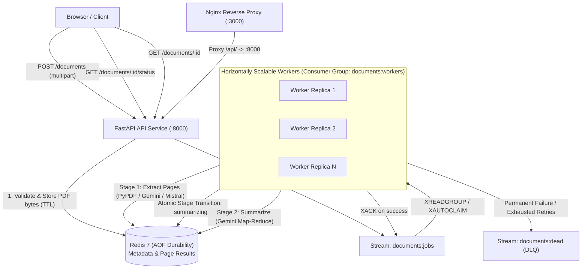

# Bwaai Async PDF Processor

A resilient, production-grade asynchronous PDF processing engine and web application. Supports batch ingestion of PDF files, multi-engine page extraction (**PyPDF** plain text, **Gemini 3.8 Flash** multimodal markdown, and **Mistral OCR** markdown), automated executive summarization, and interactive tracking via a modern React single-page application.

---

## Architecture Overview

The system decouples ingestion from heavy processing via **Redis Streams** and consumer groups, providing at-least-once delivery, horizontal worker scaling, resumable two-stage pipelines, and orphan task reclamation:



### Document Status Lifecycle

```
[Upload] ──> queued ──> processing ──> summarizing ──> done
                            │              │
                            ▼              ▼
                          failed         failed (extracted pages preserved)
```

1. **`queued`**: Files validated and enqueued to Redis Stream `documents:jobs`.
2. **`processing`**: A worker has claimed the job and is parsing pages into structured text or markdown.
3. **`summarizing`**: Pages are parsed and stored in Redis! **Clients can immediately view and read extracted pages while executive summarization proceeds**.
4. **`done`**: Executive summary generated and stored. Document is complete.
5. **`failed`**: Job encountered an unrecoverable error. If failure occurred during summarization, **all extracted pages remain accessible**.

---

## Quick Start (3 Commands)

```bash
# 1. Clone or extract archive, copy environment configuration
cp .env.example .env

# 2. (Optional) Provide Gemini and Mistral API keys in .env
# Edit .env with your keys, or leave empty (PyPDF parser works out of the box)

# 3. Launch full stack
docker compose up --build
```

- **Web Frontend**: [http://localhost:3000](http://localhost:3000)
- **API Swagger Documentation**: [http://localhost:8000/docs](http://localhost:8000/docs)
- **OpenAPI Schema Contract**: [http://localhost:8000/openapi.json](http://localhost:8000/openapi.json)
- **API Health Check**: [http://localhost:8000/health](http://localhost:8000/health)

---

## Obtaining Free API Keys

The application starts and runs cleanly with empty keys. To enable Gemini multimodal parsing, AI executive summarization, and Mistral OCR:

### Google AI Studio (Gemini)
1. Navigate to [Google AI Studio](https://aistudio.google.com/app/apikey).
2. Sign in with your Google account and select **Create API Key**.
3. Add to your `.env`:
   ```bash
   GEMINI_API_KEY=your_gemini_api_key_here
   ```

### Mistral AI
1. Navigate to [Mistral AI Console](https://console.mistral.ai/).
2. Create an account and visit the **API Keys** section.
3. Generate a new key and add to your `.env`:
   ```bash
   MISTRAL_API_KEY=your_mistral_api_key_here
   ```

---

## Horizontal Worker Scaling

Scale the background worker daemon to any number of parallel instances without container name collisions or port conflicts:

```bash
# Scale to 3 parallel worker processes
docker compose up --scale worker=3 -d

# Check cluster status and consumer registrations
docker compose ps
```

Each worker dynamically acquires a unique consumer identity (`<hostname>-<pid>-<uuid>`) in the `documents:workers` consumer group, enabling distributed parallel processing across multiple containers.

---

## API Endpoints & cURL Walkthrough

### 1. Ingestion: Upload Documents
Upload up to 10 PDF files in a single batch request, selecting `pypdf`, `gemini`, or `mistral`:

```bash
curl -X POST http://localhost:8000/documents \
  -F "files=@samples/normal.pdf;type=application/pdf" \
  -F "parser=pypdf"
```

Response (HTTP `202 Accepted`):
```json
[
  {
    "document_id": "doc_01j9a8b7c6d5e4f3a2b1c0d9e8",
    "filename": "normal.pdf",
    "status": "queued"
  }
]
```

### 2. Status Polling with Backoff Hints
Check progress using the lightweight status endpoint:

```bash
curl -i http://localhost:8000/documents/doc_01j9a8b7c6d5e4f3a2b1c0d9e8/status
```

Response:
```http
HTTP/1.1 200 OK
Retry-After: 3
Content-Type: application/json

{
  "document_id": "doc_01j9a8b7c6d5e4f3a2b1c0d9e8",
  "status": "summarizing",
  "created_at": "2026-10-31T01:00:00Z",
  "updated_at": "2026-10-31T01:00:02Z",
  "error": null
}
```

### 3. Fetch Full Document Details
Once status is `summarizing`, `done`, or `failed`:

```bash
curl http://localhost:8000/documents/doc_01j9a8b7c6d5e4f3a2b1c0d9e8
```

Response:
```json
{
  "document_id": "doc_01j9a8b7c6d5e4f3a2b1c0d9e8",
  "filename": "normal.pdf",
  "parser": "pypdf",
  "status": "done",
  "created_at": "2026-10-31T01:00:00Z",
  "updated_at": "2026-10-31T01:00:05Z",
  "pages": [
    {
      "page_number": 1,
      "content": "ANNUAL PERFORMANCE REPORT - FY2026\nSection 1: Executive Overview...",
      "format": "text"
    }
  ],
  "summary": "This document summarizes FY2026 performance with 34.2% YoY revenue growth.",
  "error": null
}
```

### 4. Paginated Document List
```bash
curl "http://localhost:8000/documents?limit=10"
```

---

## Testing & Quality Assurance

Run test suites and linters locally or via Makefile:

```bash
# Run all tests, linters, and OpenAPI contract checks in one command
make check

# Or test backend and frontend individually:
cd backend && uv run pytest -v
cd frontend && npm run test
```

---

## Measured Load Test Benchmarks

Benchmarks executed against the staged Docker Compose stack using `scripts/load_test.py` with 30 PDF documents and 10 concurrent requests:

| Benchmark Metric | 1 Worker Instance | 3 Worker Instances |
|---|---|---|
| **Total Processed Documents** | 30 / 30 | 30 / 30 |
| **Error Rate** | 0.0% | 0.0% |
| **Upload Latency p50** | 24.9 ms | 32.3 ms |
| **Upload Latency p95** | 43.2 ms | 40.6 ms |
| **End-to-End Latency p50** | 1.05 s | 1.05 s |
| **End-to-End Latency p95** | 1.07 s | 1.08 s |
| **Throughput (docs/sec)** | 9.07 docs/sec | 9.32 docs/sec |
| **Peak Concurrent In-Flight** | 10 | 10 |

---

## Key Design Decisions & Assumptions

1. **Redis Streams as Durable Queue**:
   - Out-of-the-box Redis Streams provides consumer groups, message acknowledgment (`XACK`), pending entry lists (`XPENDING`), dead-letter routing, and automatic recovery (`XAUTOCLAIM`) without needing RabbitMQ or Kafka.
2. **Redis AOF Persistence & Eviction Policy**:
   - Redis runs with `--appendonly yes` and `--maxmemory-policy noeviction`. If memory limits are approached, Redis returns an error rather than silently evicting queued tasks or document metadata.
3. **Resumable Pipeline with Early Page Availability**:
   - The two-stage worker architecture transitions document status to `summarizing` immediately upon completing parsing. Extracted pages are rendered right away for the user, and if summarization fails (e.g. rate limits or missing keys), previously parsed pages are preserved.
4. **Nginx Reverse Proxy Upload Limits**:
   - Nginx is tuned with `client_max_body_size 300M` and `proxy_request_buffering off` to allow full 10-file batch uploads up to 25MB each without premature gateway rejection.
5. **Zero Host Network Dependency**:
   - The frontend, API, worker, and Redis communicate entirely over an internal bridge network.
6. **Distributed Mutual Exclusion & Active Lease Renewal**:
   - To prevent long-running AI API calls (> 60s) from being prematurely reassigned by `XAUTOCLAIM` and duplicated across multiple workers, workers acquire `doc:lock:{id}` (`NX EX 30`) and execute an active background heartbeat that renews the lock TTL and resets the stream message's pending idle time via `XCLAIM ... JUSTID` every 10 seconds. `AutoClaimer` also checks for active locks before dispatching.
7. **Poison-Pill Crash Protection & DLQ Routing**:
   - Fatal worker process crashes (OOM kills, `kill -9`, native segfaults) bypass Python `try...except` exception handlers. A pre-execution entry guard inspects `delivery_count > MAX_ATTEMPTS` before parsing starts; if exceeded, the job is immediately marked `failed` with code `PARSER_FAILED`, published to the dead-letter stream `documents:dead`, and acknowledged via `XACK` to break infinite crash loops.

---

## Known Limitations & Future Improvements

1. **Local Redis Binary Storage**:
   - For production high-throughput deployments exceeding tens of thousands of PDFs daily, raw PDF binaries should be migrated from Redis (`doc:{id}:file`) to S3/GCS with signed download URLs.
2. **WebSocket / Push Notifications**:
   - While HTTP polling with `Retry-After` is simple, stateless, and reliable, adding optional WebSockets or SSE would provide instant notifications for active browser sessions.
3. **Multi-Region Worker Distribution**:
   - Distributing worker daemons across multiple cloud regions using Valkey/Redis Cluster for geographic latency reduction.
